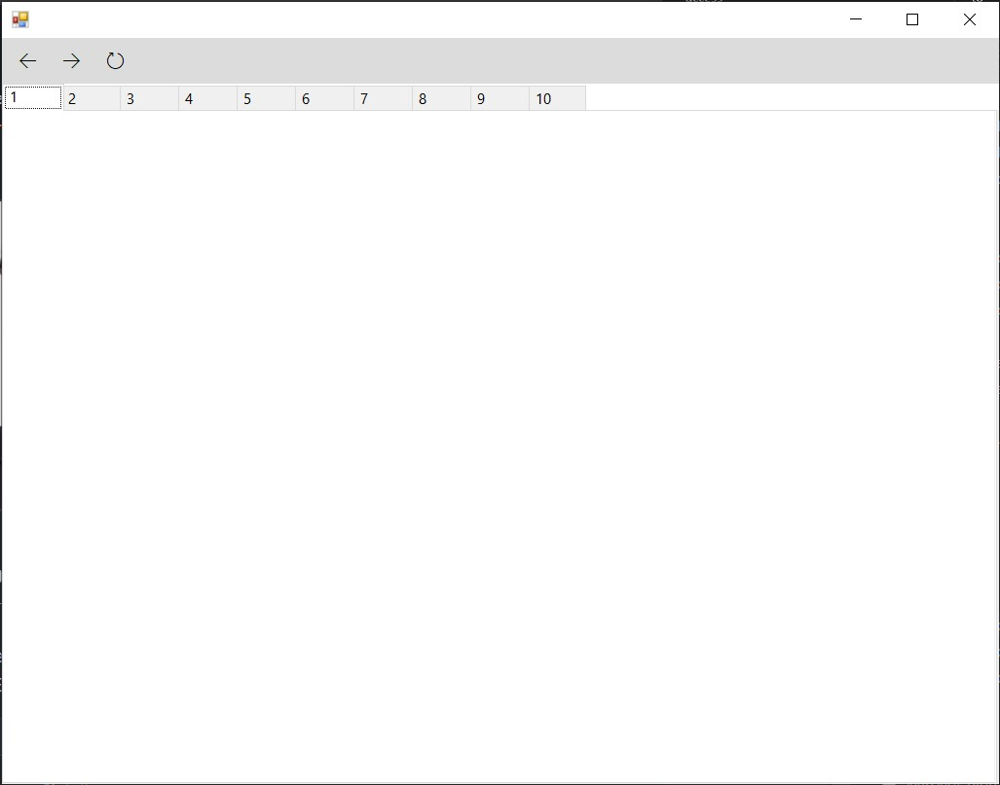

# 💬 SuperWhatsapp – Multi‑Session WhatsApp Web Desktop Client



A **Windows desktop application** that opens up to **ten independent WhatsApp Web sessions** in a single window.  
Each session is isolated and persistent, so you do not need to scan the QR code again after closing and reopening the app.

> **Repository description:** *“Opens up to ten whats app web in one application and will keep all sessions so you don't need to login every time close/reopen the app”* [reference:0]

---

## 📖 Overview

`SuperWhatsapp` is a **C# WinForms** application built on **CefSharp** (the .NET binding for the Chromium Embedded Framework).  
It embeds ten `ChromiumWebBrowser` controls inside a tabbed interface, each pointing at `web.whatsapp.com` but running in its **own isolated request context** with a **separate cache directory**.  
This design gives every tab its own cookies, local storage, and login state — effectively ten independent WhatsApp Web accounts in one process.

The application also includes a navigation bar (back, forward, refresh), an About dialog, and an optional licensing module (currently commented out in `Program.cs`).

---

## ✨ Features

- **Up to 10 simultaneous WhatsApp Web sessions** — each in its own tab.
- **Persistent login per session** — each tab stores its data in a dedicated cache folder under `%LOCALAPPDATA%\CefSharp\Cache\SuperWhatsapp\<n>`.
- **Tabbed interface** — switch between accounts without closing other sessions.
- **Navigation controls** — back, forward, and refresh for the active tab.
- **CEF‑based rendering** — full Chromium engine via CefSharp, not a lightweight WebView.
- **About dialog** — shows application information.
- **Optional licensing support** — `Register.cs` and `ActivateForm` are present but the license check is currently commented out in `Program.cs`.

---

## 🗂️ Repository Structure

```text
SuperWhatsapp/
├── MultiWhatsapp.sln                # Visual Studio solution
├── SuperWhatsapp/                   # Main WinForms project
│   ├── Forms/
│   │   ├── Form1.cs                 # Main tabbed window (creates 10 browsers)
│   │   ├── Form1.Designer.cs        # UI layout (tabControl, navBar, buttons)
│   │   ├── Form1.resx
│   │   ├── AboutBox.cs              # About dialog
│   │   ├── AboutBox.Designer.cs
│   │   ├── AboutBox.resx
│   │   ├── ActivateForm.cs          # Licensing activation form (unused)
│   │   ├── ActivateForm.Designer.cs
│   │   ├── ActivateForm.resx
│   │   ├── BaseForm.cs
│   │   ├── SplashForm.cs            # Splash screen (unused)
│   │   ├── SplashForm.Designer.cs
│   │   └── SplashForm.resx
│   ├── Properties/                  # Assembly info, settings, resources
│   ├── Resources/                   # Icons and images
│   ├── App.config                   # Application configuration
│   ├── ControlExtensions.cs         # UI thread helper (from CefSharp samples)
│   ├── MultiWhatsapp.csproj         # Project file (.NET Framework 4.5.2)
│   ├── Program.cs                   # Entry point + CEF initialization
│   ├── Register.cs                  # Licensing logic (Standard.Licensing)
│   ├── Util.cs                      # UI helpers (splash screen, Persian calendar)
│   └── README.md                    # Minimal description
├── app.jpg                          # Screenshot
├── .gitattributes
└── .gitignore
```

## 🛠️ Technologies

|Item|Details|
|---|---|
|**Language**|C#|
|**UI framework**|Windows Forms (WinForms)|
|**Embedded browser**|**CefSharp** (`CefSharp.Common`, `CefSharp.WinForms`) version **92.0.260**[](https://raw.githubusercontent.com/alisepehrnia/SuperWhatsapp/master/SuperWhatsapp/MultiWhatsapp.csproj)|
|**Target framework**|**.NET Framework 4.5.2** (x86 and x64)[](https://raw.githubusercontent.com/alisepehrnia/SuperWhatsapp/master/SuperWhatsapp/MultiWhatsapp.csproj)|
|**Licensing library**|`Standard.Licensing` (used in `Register.cs`, but license check is commented out)[](https://raw.githubusercontent.com/alisepehrnia/SuperWhatsapp/master/SuperWhatsapp/Register.cs)|
|**Platform**|Windows only (WinForms + CEF)|

---
## 🧠 How It Works

### 1. Application startup

`Program.Main` initializes CEF with media‑stream permissions enabled (for WebRTC / calls) and then launches the main form `Form1`:

```csharp
Cef.EnableHighDPISupport();
var settings = new CefSettings();
settings.CefCommandLineArgs.Add("enable-media-stream");
settings.CefCommandLineArgs.Add("use-fake-ui-for-media-stream");
settings.CefCommandLineArgs.Add("enable-usermedia-screen-capturing");
Cef.Initialize(settings, true, browserProcessHandler: null);
_mainForm = new Form1();
Application.Run(_mainForm);
```

### 2. Ten isolated browser sessions

`Form1` creates **10 `ChromiumWebBrowser` controls** in a loop.  
For each tab, it builds a **separate `RequestContext`** with its own cache path:

```csharp
for (var i = 1; i <= 10; i++)
{
    var reqCtx = ctxBuilder
        .PersistUserPreferences()
        .WithCachePath(Path.Combine(_cacheRoot, i.ToString()))
        .Create();
    var ctrl = new ChromiumWebBrowser(Webapp, reqCtx) { ActivateBrowserOnCreation = true };
    _browsers.Add(ctrl);
    var tabPage = new TabPage(i.ToString());
    tabPage.Controls.Add(ctrl);
    tabControl.TabPages.Add(tabPage);
}
```

Because each `RequestContext` uses a **different cache directory** (`...\SuperWhatsapp\1`, `...\SuperWhatsapp\2`, …), cookies and local storage are isolated per tab.  
This is what allows ten independent WhatsApp Web logins to persist across restarts.

### 3. Navigation and lifecycle

- **Refresh** → `ActiveBrowser.Reload()`.
- **Back / Forward** → `CanGoBack` / `CanGoForward` checks.
- **About** → opens `AboutBox`.
- **On close** → disposes all browsers and calls `Cef.Shutdown()`.  
### 4. Licensing (disabled)

`Register.cs` contains a full license‑reading and validation implementation using `Standard.Licensing`, and `Program.cs` contains commented‑out code that would check for a license file at startup.  
The active `Main` method **skips** this check entirely, so the application currently runs without a license.  

---
## 🚀 Getting Started

### Prerequisites

- **Windows** (7 or later).
- **Visual Studio 2019/2022** with the **.NET desktop development** workload.
- **.NET Framework 4.5.2** targeting pack.
- **NuGet** package restore (CefSharp packages are not committed to the repository).
### Build and Run

1. **Clone the repository**
    
    ```bash
    git clone https://github.com/alisepehrnia/SuperWhatsapp.git
    cd SuperWhatsapp
    ```
    
1. **Open the solution**
    
    - Open `MultiWhatsapp.sln` in Visual Studio.
        
2. **Restore NuGet packages**
    
    - Right‑click the solution → **Restore NuGet Packages**.  
        (The `.csproj` references `CefSharp.Common` and `CefSharp.WinForms` v92.0.260 from `..\packages\`.)
        
3. **Build and run**
    - Select the **x86** platform (the project includes x86 configurations).
    - Press **F5** or **Ctrl+F5**.

> **Note:** CefSharp requires the Visual C++ runtime and a specific folder structure for its native libraries. If the app fails to start, ensure that the `x86` build output contains the `CefSharp` native DLLs (they are copied from the NuGet package during build).

---
## 💻 Usage

1. Launch the application.
2. Select a tab (1–10).
3. Scan the WhatsApp Web QR code with the phone for that account.
4. Repeat for each account you want to run simultaneously.
5. Close the app when done — **each tab’s session is saved** in its own cache folder.
6. Reopen the app later; all sessions will restore without re‑scanning.

---
## ⚠️ Notes & Caveats

- **Windows‑only** — WinForms and CefSharp are not cross‑platform.
- **x86 build** — the project defines x86 configurations; CefSharp native binaries must match the build architecture.
- **Licensing is disabled** — the license check in `Program.cs` is commented out. The app currently runs without activation.
- **No installer included** — you build and run from Visual Studio (or publish manually).
- **CefSharp version 92** — this is an older CEF build; if WhatsApp Web requires a newer Chromium engine, you may need to upgrade the CefSharp NuGet packages.

---
## 🤝 Contributing

Issues and pull requests are welcome — e.g. upgrading CefSharp, enabling the licensing module, adding a session‑management UI, or providing an installer.

---
## 📄 License

Feel free to use :)

---
## 🙏 Acknowledgements

- **CefSharp** – the .NET binding for the Chromium Embedded Framework.
- **WhatsApp Web** – the web client embedded in each tab.
